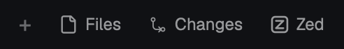

# herdr-zed

Open the current Herdr space in [Zed](https://zed.dev) from the tab bar.



## Description

herdr-zed adds a **Zed** button to the tab bar of the
[Herdr](https://herdr.dev) desktop app. The button is next to
**Files** and **Changes**.

When you click **Zed**, Zed opens on this computer:

| Space type  | Zed opens                                              |
| ----------- | ------------------------------------------------------ |
| Local       | The folder, as a local project.                        |
| SSH machine | The folder on the remote machine, as a remote project. |

The folder is one of these, in this sequence:

1. The root of the git repository of the focused terminal.
2. The folder of the focused terminal.
3. The home folder on the machine of the space.

For an SSH machine, herdr-zed gets the SSH host from `hc machine ls`.
Then it runs `zed ssh://<host>/<folder>`. Zed uses your `~/.ssh/config`.

A notification shows the result.

## Requirements

- The Herdr desktop app, version 0.1.12 or later, on macOS.
- Zed, installed in `/Applications`.
- The Zed CLI on your `PATH`. To install it, open Zed and run
  `cli: install cli binary` from the command palette.
  If the CLI is not on your `PATH`, herdr-zed uses
  `/Applications/Zed.app/Contents/MacOS/cli`.
- For a remote space: a Herdr machine that connects with SSH.
  A machine that connects with `--via` is not supported.

## Install

1. Clone the repository:

   ```sh
   git clone https://github.com/nsudhanva/herdr-zed.git
   cd herdr-zed
   ```

2. Make sure that the Herdr app is open.
3. Run the install script:

   ```sh
   ./install.sh
   ```

The script copies the files into `~/.config/herdr-app`, checks the mod,
and switches the window to the `main-zed` layout.

If the files exist, the script stops. To replace them, run
`./install.sh --force`.

To use a different Herdr home folder, set `HERDR_APP_HOME`.

## Update

1. Get the new version:

   ```sh
   git pull
   ```

2. Run the install script again:

   ```sh
   ./install.sh --force
   ```

## Use

1. Select a space.
2. Click a terminal in the repository that you want to open.
3. Click **Zed** in the tab bar.

While Zed starts, the button shows **Opening…**. The first connection to
a remote machine can take more time, because Zed installs its server
there.

## Remove

Run the uninstall script:

```sh
./uninstall.sh
```

The script switches the window back to the `main` layout and removes
the files.

To go back to the `main` layout and keep the files, push
`ctrl-shift-l`.

## How it works

Herdr does not let you change its shipped mods and layouts. Thus
herdr-zed has modified copies of them:

| File                    | Copy of       | Change                                  |
| ----------------------- | ------------- | --------------------------------------- |
| `layouts/main-zed.json` | `main` layout | The tab bar uses `zed-tabs`.            |
| `mods/zed-tabs/`        | `tabs` mod    | Adds the **Zed** button.                |
| `mods/zed-tabs/zed.js`  | (new)         | Finds the folder and starts Zed.        |

## Limits

- Herdr updates do not change these copies. When Herdr changes its
  tab bar, install a new version of herdr-zed.
- If the remote terminal does not send its folder to Herdr, Zed opens
  the home folder on the remote machine.
- herdr-zed is tested on macOS only.

## License

Apache License 2.0. Some files are modified copies of files from the
Herdr app. Refer to [NOTICE](NOTICE) and [LICENSE](LICENSE).
